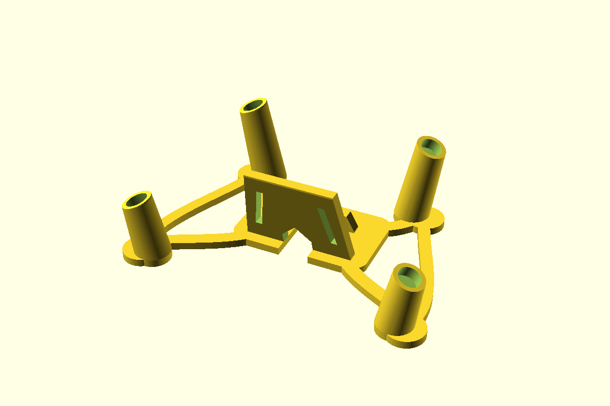
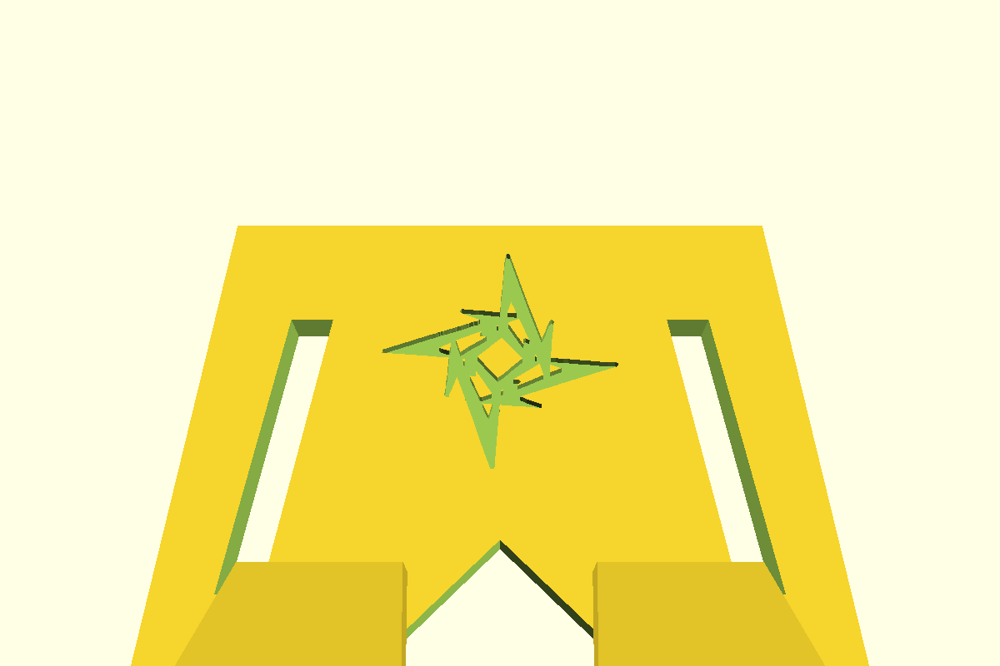
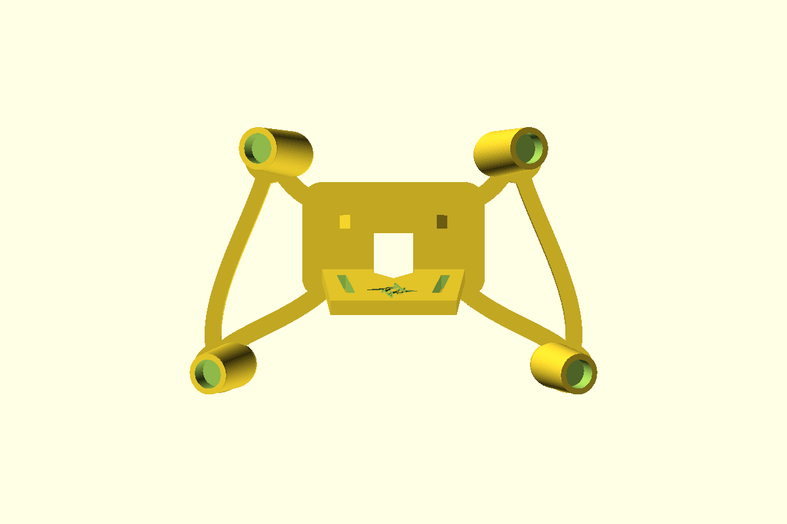
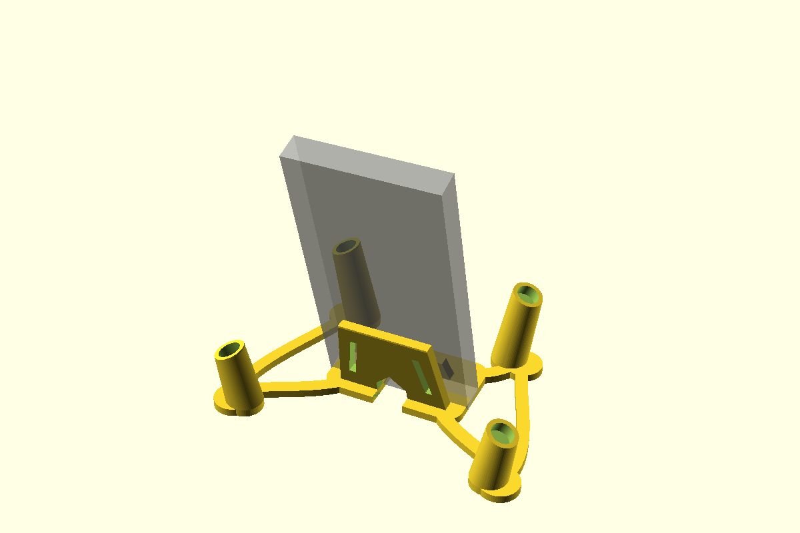
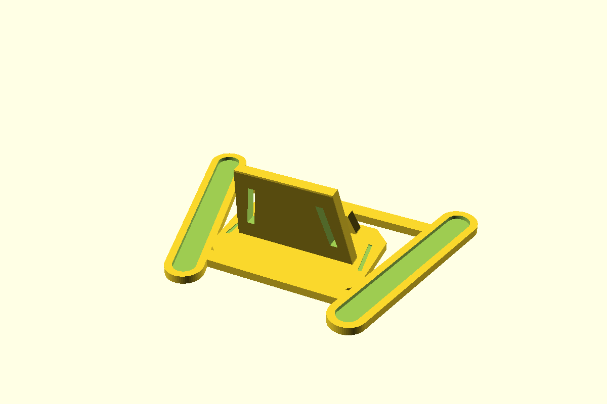

# W O M O D E L S

```text
+------------------------------------------------------------------+
|                                                                  |
|    Practical models for keyboards, desks, and other projects.    |
|                                                                  |
|    Source files  /  Printable parts  /  Room to tinker           |
|                                                                  |
+------------------------------------------------------------------+
```

Each keyboard perch has editable source, a Makefile, and ready-to-print files
in its own directory.

## Models

| Model | Description | Files |
| --- | --- | --- |
| Glove80 Perch | One-piece 22-degree on-desk tenting frame with a central phone cradle | [STL](glove80/build/glove80_perch.stl) · [source](glove80/glove80_perch.scad) · [details](glove80/README.md) |
| Go60 Perch | Keyboard positioning base with a centered phone cradle | [STL](go60/build/go60_perch.stl) · [source](go60/go60_perch.scad) |

### Glove80 Perch

The four angled sockets locate the two inner legs of each keyboard half. The
outer feet rest on the desk. The cradle includes a rear cable channel and a
recessed mark on its phone-facing side.

| Overall render | Front mark detail |
| --- | --- |
|  |  |

| Socket layout | Phone fit estimate |
| --- | --- |
|  |  |

The translucent block shows an **estimated 84 × 15 × 168 mm phone and case**.
The frame measures about **179.4 × 117.6 × 56.1 mm** and fits on a 220 × 220 mm
bed. The phone rests about 4.5 mm above the desk; check clearance for your
charging plug. See the [Glove80 details](glove80/README.md) for socket dimensions
and fit guidance.

### Go60 Perch



The [Go60 source](go60/go60_perch.scad) and [printable STL](go60/build/go60_perch.stl)
are in `go60/`. The model is also [published on Printables](https://www.printables.com/model/1881381-go60-perch).

## Build from source

Install [OpenSCAD](https://openscad.org/) and `make`. OpenSCAD must be available
as `openscad` on your PATH. To print a checked-in STL, you only need a slicer;
OpenSCAD and `make` are for rebuilding or editing the model.

```sh
make -C glove80                # Glove80 STL and overall render
make -C glove80 top logo phone # Additional Glove80 views
make -C go60                   # Go60 STL and render
```

Run `make -C glove80 help` or `make -C go60 help` for the other export and
preview targets, including 3MF. Generated files go into each model's `build/`
directory.

## Print the Glove80 Perch

Place the [Glove80 STL](glove80/build/glove80_perch.stl) flat on its frame. For
PLA with a 0.4 mm nozzle, a useful starting point is **0.20 mm layers, 4
perimeters, 5 top and bottom layers, and 15% gyroid infill**. Supports are not
needed. Add a brim only if the foot pads lift on your printer. Use your tested
PLA temperature and speed profile.

The socket openings are 12.5 mm. Check your feet or leg adapters against the
[dimensions and fit guidance](glove80/README.md#dimensions-and-fit) before
printing.

## Repository map

```text
.
|-- glove80/    # OpenSCAD source, artwork, build steps, STL, and renders
|-- go60/       # OpenSCAD source, build steps, STL, and render
|-- houseCup/   # House Cup models and print notes
|-- LICENSE
`-- README.md
```

## License

See [LICENSE](LICENSE).
