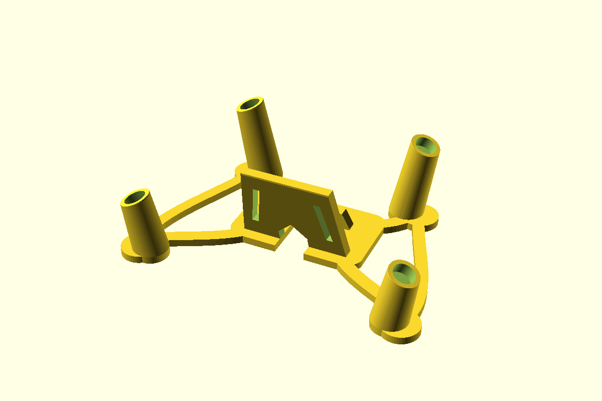

# Glove80 perch

[Printable STL](build/glove80_perch.stl) · [OpenSCAD source](glove80_perch.scad) · [Top view](build/glove80_perch_top.png) · [Logo detail](build/glove80_logo_detail.png)

A one-piece, 22° on-desk tenting frame for the Glove80 with a central portrait
phone cradle. Four angled sockets locate the rear inner and thumb-cluster legs;
the outer feet rest on the desk. Curved rails join the sockets to the cradle.
The cradle has a split front lip, a cable path entering from the rear, and a
0.8 mm recessed mark on its phone-facing backrest.

## Dimensions and fit

All dimensions are in millimetres. The STL is approximately **179.4 × 117.6 ×
56.1 mm** and fits on a 220 × 220 mm print bed.

| Feature | Default |
| --- | ---: |
| Socket opening | 12.5 mm diameter |
| Socket recess | 6 mm deep, angled 22° |
| Socket spacing at thumb row | 111 mm between centres |
| Socket spacing at rear row | 157 mm between centres |
| Distance between socket rows | 95 mm |
| Rear cable opening | 18 mm wide |

The socket layout follows [MoErgo's Glove80 leg positions](https://docs.moergo.com/glove80-user-guide/appendix-custom-mounting/)
and the [22° on-desk mount](https://www.printables.com/model/1744348-glove80-spacer-tenting-mount-and-armrest).
Check the diameter of your feet or leg adapters against the 12.5 mm openings.
Foot dimensions vary with the adapters and rubber caps you use.

The [phone preview](build/glove80_phone_fit.png) shows an **estimated 84 × 15 ×
168 mm** envelope for a Pixel 9 Pro XL in a Peak Design case. Measure your case
for a precise fit. The rear cable path reaches the phone slot, but the phone
rests about 4.5 mm above the desk. Check connector clearance with your actual
cable, especially for a straight USB-C plug.

## Print

Place the STL flat on its frame. For PLA with a 0.4 mm nozzle, start with 0.20
mm layers, 4 perimeters, 5 top and bottom layers, and 15% gyroid infill. Print
without supports. Add a brim if the foot pads lift from your build plate.

## Build and adjust

Install [OpenSCAD](https://openscad.org/) and `make`, then run `make` in this
directory to generate the STL and main render in `build/`. Run `make top logo
phone` for the other views, or `make help` for all targets.

Edit [glove80_perch.scad](glove80_perch.scad) to adjust `foot_socket_diameter`,
`tent_deg`, `inner_foot_gap`, `splay_deg`, and `phone_rearward` for your setup.
Set `with_palmrests = true` for inner palm-rest sockets, `outer_sockets = true`
for outer leg sockets, or `with_front_logo = false` for a plain backrest. The
recessed artwork is in [glove80_mark.svg](glove80_mark.svg).
